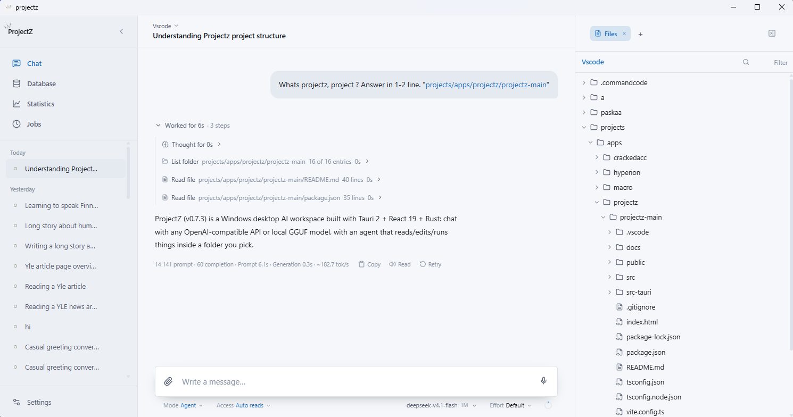
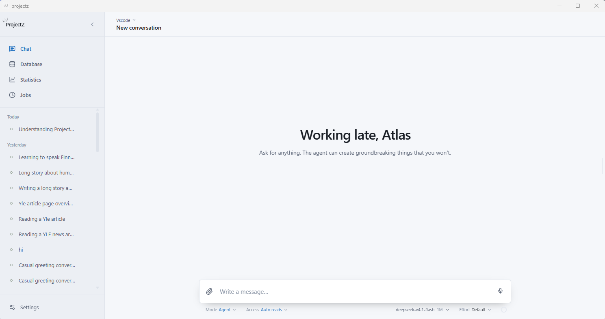
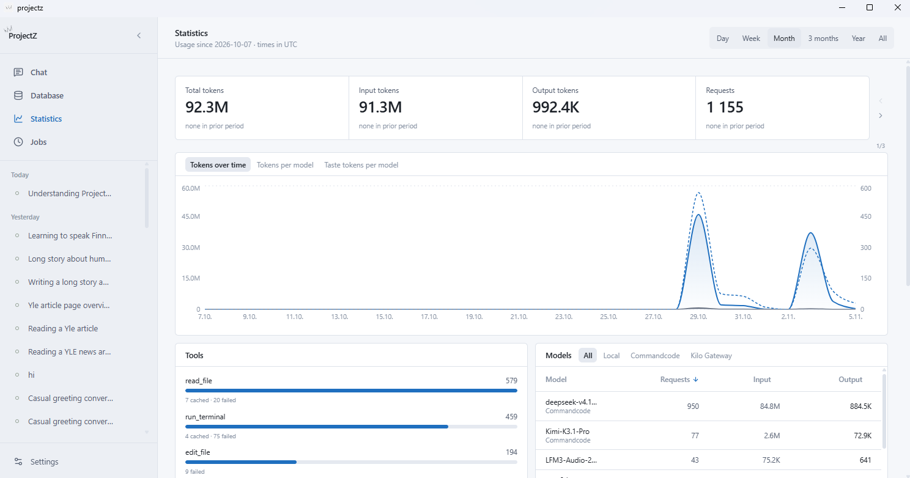
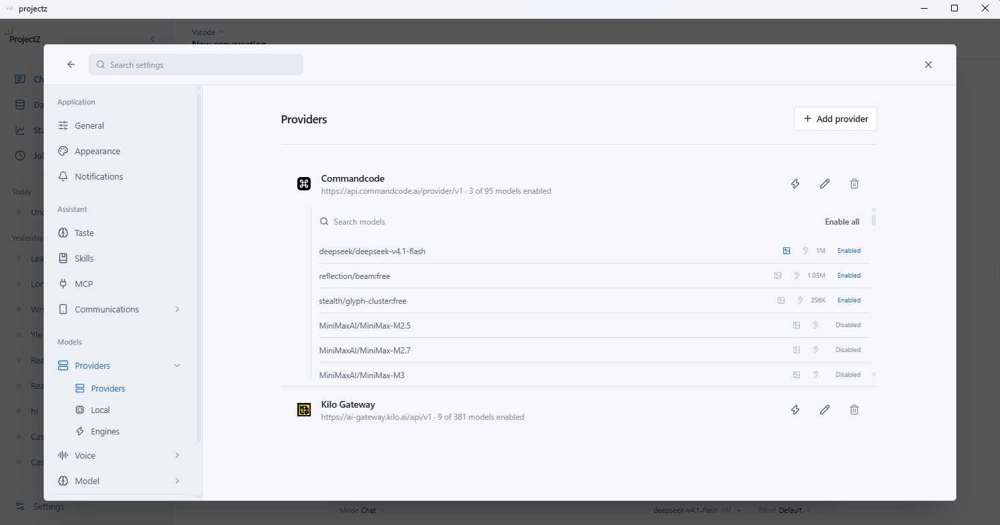
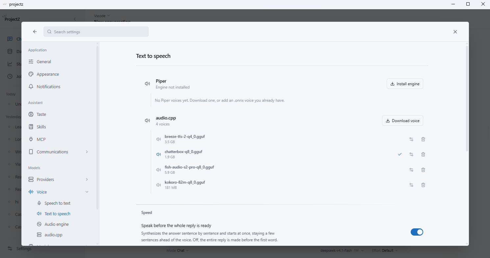

<div align="center">


# ProjectZ

**One window. Every model. Your actual files.**

A desktop AI workspace. Chat with any OpenAI-compatible API or a local GGUF model —
then let the agent read, edit and run things inside a folder you choose.

[](https://github.com/Herra-Atlas/projectz/releases)


[Download](https://github.com/Herra-Atlas/projectz/releases) · [Features](#built-for-real-work) · [Screenshots](#screenshots) · [Build from source](#build-from-source)

</div>



## Built for real work

**Agent mode, with brakes.** The agent reads, greps, edits, writes, runs commands and delegates to sub-agents. Four access levels decide what it may do without asking, and every step is a row you can inspect, approve or stop.

**Bring your own model.** Any OpenAI-compatible provider, or `llama.cpp` running your own GGUF files. Local models show their context window and VRAM fit before you load one — and what runs is exactly what the settings page shows.

**Your files stay yours.** Pick a workspace folder and the tools are confined to it. The file tree, previews, editor, terminal and drag-and-drop file operations all work in the same boundary.

**Voice, both directions.** Push-to-talk dictation with whisper.cpp, Parakeet or audio.cpp. Replies read aloud with Piper — including hands-free auto-speak. Wake word and speaker recognition are optional, local, and off by default.

**It keeps working when you stop.** Scheduled jobs run with their own access set, lanes and machine conditions, and land back in the sidebar as ordinary conversations. The same agent answers from Telegram, with per-person permissions.

**Nothing hidden in the bill.** Tokens, requests, cache hits and tool calls are recorded per reply and per period. The Database page is a read-only window into everything stored.

## Screenshots

**Ask a question — or hand it the keyboard.**



**Every token, request and tool call, measured.**



**Bring your own providers — enable only the models you want.**



**A local voice engine, with the voices you installed and nothing else.**



## Build from source

Requirements: Windows 10/11 with WebView2, Node 20+, and a stable Rust toolchain.

```bash
npm install
npm run tauri dev     # development
npm run tauri build   # installer
```

## Under the hood

- **Tools live in Rust.** Every file, search, terminal and web call runs natively — no IPC round trip per tool call.
- **Two permission gates.** One asks *may this run do this without asking*, the other *may it do this at all* — enforced again against installation-wide switches.
- **SQLite for state.** Conversations, jobs, taste, usage and per-conversation tool caches survive restarts.
- **Tauri 2 + React 19 + TypeScript + Tailwind.** Native window, tray and tray menu; charts and previews read the app's design tokens.

<div align="center">

<sub>Version 0.7.3 · Windows</sub>

</div>
